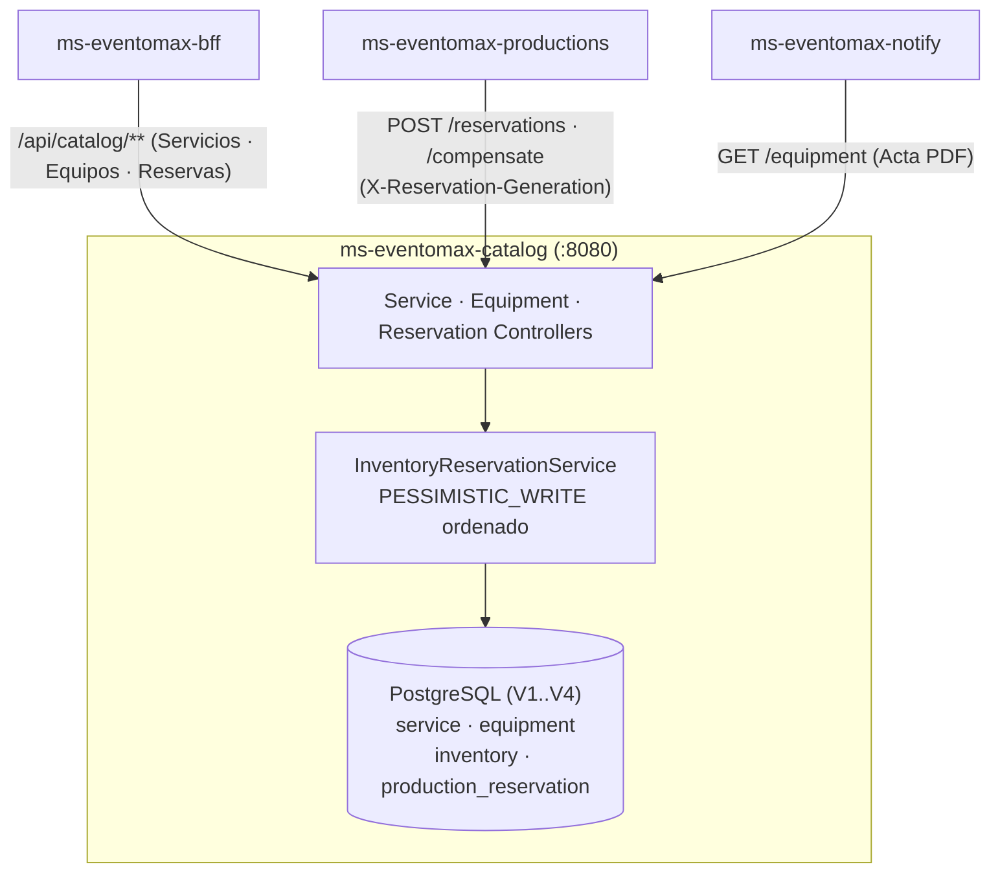

<a href="https://7dewsdyt7i.execute-api.us-east-1.amazonaws.com/swagger-ui/index.html">
  
</a>

> **Caso de Estudio 8:** Plataforma B2B de Producción y Montaje de Eventos &nbsp;|&nbsp; **Asignatura:** Desarrollo Cloud Native (`DSY1107`) &nbsp;|&nbsp; **Equipo:** Ignacio Valeria, Benjamín Flores, Benjamín Espinoza

## Propósito del Repositorio

`ms-eventomax-catalog` administra el catálogo maestro de servicios contratables, el inventario físico de equipamiento técnico (sonido, iluminación, escenarios, video) y las reservas atómicas por producción en **EventoMax**:

- **Concurrencia Pesimista Sin Deadlocks:** Las reservas multi-ítem adquieren bloqueos `PESSIMISTIC_WRITE` ordenando los registros por `equipmentId` ascendente (`InventoryReservationService`), garantizando consistencia estricta del stock disponible sin bloqueos cruzados.
- **Lecturas Limpias Sin Contención:** Los endpoints `GET /api/catalog/equipment` y las consultas referenciales de disponibilidad evitan bloqueos de fila para no frenar el portal ni el armado de Actas PDF desde `ms-eventomax-notify`.
- **Compensación Saga Idempotente:** Soporta reintentos mediante `idempotencyKey` y protección contra reordenamientos temporales mediante `X-Reservation-Generation` (*generation fencing*).
- **Soporte Visual de Catálogo:** Almacena URLs o imágenes optimizadas (`image_url` en `V4`) para servicios y equipamiento mostrados en el portal operativo.

## Accesos Relacionados (Demo AWS)

| Recurso | Enlace HTTPS | Acceso |
| :--- | :--- | :--- |
| **Swagger UI (Tags `Catálogo - Servicios / Equipos / Reservas`)** | [Abrir Swagger UI](https://7dewsdyt7i.execute-api.us-east-1.amazonaws.com/swagger-ui/index.html) | Lectura pública · `Bearer <JWT>` |
| **Portal Web EventoMax** | [Abrir Portal Web](https://eventomax-production-portal-app.s3.us-east-1.amazonaws.com/index.html) | Microsoft Entra ID (OAuth 2.0 PKCE) |

## Endpoints Expuestos (`expose 8080`)

Todo el tráfico externo transita por AWS API Gateway y `ms-eventomax-bff` en la red privada `eventomax-net`.

| Método | Ruta | Consumidor / Uso | Descripción |
| :--- | :--- | :--- | :--- |
| `GET` | `/api/catalog/services` | BFF (`Admin`, `Productor`) | Lista servicios técnicos activos del catálogo |
| `GET` | `/api/catalog/services/{id}` | BFF (`Admin`, `Productor`) | Consulta el detalle de un servicio |
| `POST` / `PUT` | `/api/catalog/services` · `/{id}` | BFF (`Admin`) | Crea o actualiza servicio, tarifa e imagen |
| `GET` | `/api/catalog/equipment` · `/{id}` | BFF (`Admin`, `Productor`) · `notify` | Lista equipos junto a stock total, disponible y reservado (sin lock) |
| `POST` / `PUT` | `/api/catalog/equipment` · `/{id}` | BFF (`Admin`) | Registra equipo nuevo o ajusta stock validando reservas activas |
| `POST` | `/api/catalog/reservations` | `ms-eventomax-productions` | Reserva atómica e idempotente (acepta `X-Reservation-Generation`) |
| `GET` | `/api/catalog/reservations/production/{productionId}` | BFF (`Admin`, `Productor`, `Organizador`) | Consulta reservas asociadas a una producción |
| `POST` | `/api/catalog/reservations/production/{productionId}/compensate` | `ms-eventomax-productions` | Libera stock reservado por cancelación o fallo Saga |
| `GET` | `/actuator/health`, `/actuator/info` | Interno | Sondeo de salud del contenedor |

## Base de Datos y Migraciones Flyway (`V1..V4`)

| Versión | Script | Cambios |
| :--- | :--- | :--- |
| `V1` | `V1__create_service_table.sql` | Tabla `service` con catálogo base de servicios |
| `V2` | `V2__create_equipment_inventory_reservation_tables.sql` | Tablas `equipment`, `inventory` y `production_reservation` |
| `V3` | `V3__reservation_generations.sql` | Tabla `reservation_generations` para *generation fencing* |
| `V4` | `V4__add_catalog_image_url.sql` | Columna `image_url` en `service` y `equipment` |

## Stack Tecnológico

<table>
  <tr>
    <td align="center" width="20%">
      <br />
      <strong>Java 25 · Boot 4.1.1</strong>
    </td>
    <td align="center" width="20%">
      <br />
      <strong>PostgreSQL · Flyway</strong>
    </td>
    <td align="center" width="20%">
      <br />
      <strong>Amazon RDS (schema)</strong>
    </td>
    <td align="center" width="20%">
      <br />
      <strong>Docker (512m)</strong>
    </td>
    <td align="center" width="20%">
      <br />
      <strong>EC2 Apps Host</strong>
    </td>
  </tr>
</table>

## Arquitectura del Módulo



## Variables de Entorno y Verificación

| Variable | Ejemplo | Descripción |
| :--- | :--- | :--- |
| `DB_URL` | `jdbc:postgresql://<POSTGRES_HOST>:5432/eventomax?currentSchema=catalog` | URL JDBC hacia PostgreSQL / RDS |
| `DB_USER` / `DB_PASSWORD` | `eventomax_prod` / `<SECRET>` | Credenciales del esquema `catalog` |
| `DB_SCHEMA` / `FLYWAY_CREATE_SCHEMAS` | `catalog` / `true` | Esquema aislado gestionado por Flyway |
| `JAVA_TOOL_OPTIONS` | `-XX:InitialRAMPercentage=25.0 -XX:MaxRAMPercentage=65.0` | Presupuesto de heap (`mem_limit: 512m`) |

```bash
# Ejecutar pruebas unitarias y de concurrencia con Testcontainers PostgreSQL
./mvnw -B -ntp verify

# Desplegar en Docker (mem_limit: 512m)
docker compose --env-file .env.prod -f docker-compose.prod.yml up -d --build
```
